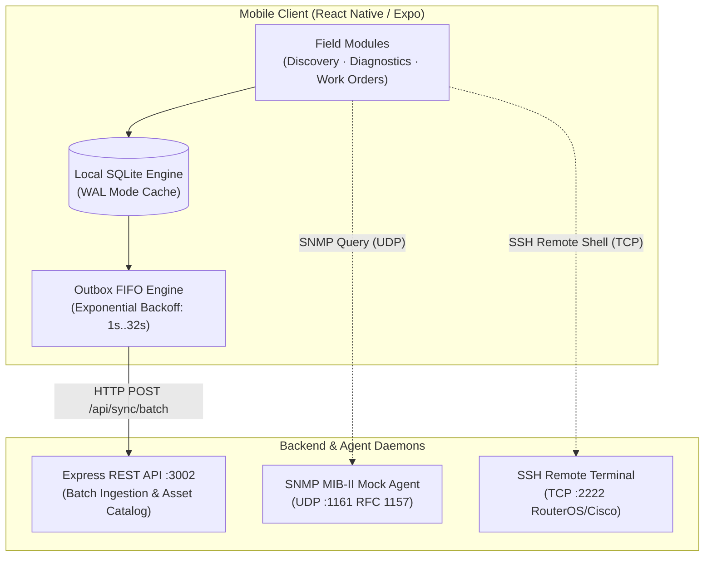

# Network Diagnostics Suite

> **Enterprise Telecom Field Diagnostic Toolkit & Offline-First Commissioning Platform**

[](https://reactnative.dev/)
[](https://expo.dev/)
[](https://www.typescriptlang.org/)
[](https://www.sqlite.org/)
[](https://nodejs.org/)

A cross-platform mobile and web engineering toolkit designed for telecommunications field technicians and network engineers. Provides automated subnet discovery, ASN.1/BER binary SNMP MIB-II diagnostics, hardware-keystore protected SSH remote management, barcode asset cataloging, photographic evidence capture, and tamper-evident PDF commissioning certification backed by a fault-tolerant **Offline-First Outbox Engine**.

---

## Architecture Overview



---

## Core Capabilities

### 1. Offline-First Outbox Synchronization Engine
- **Transactional Enqueueing**: Every field action (discovered device, diagnostic run, commissioning work order) is immediately recorded in SQLite and queued as an `outbox_events` record within the same local transaction.
- **State Machine Transitions**:
  - `PENDING`: Event recorded locally in SQLite, waiting for network availability or active sync cycle.
  - `IN_FLIGHT`: Event batch dispatched to `/api/sync/batch` awaiting server acknowledgment.
  - `PROCESSED`: Server returned HTTP 200 acknowledgment; event safely marked as processed.
  - `FAILED`: Network timeout or 5xx error; scheduled for retry using exponential backoff ($2^{\text{retry}} \times 1000\text{ ms}$, max 5 retries).
- **Zero Data Loss**: Full operational capability in isolated field environments (telecom towers, subterranean vaults, unserviced rural nodes). Automatically drains queue upon network restoration.
- **SQLite WAL Mode**: Configured with `PRAGMA journal_mode = WAL;` and `PRAGMA synchronous = NORMAL;` for high-throughput concurrent writes with async native mutex locking.

### 2. Network Protocols & Security Architecture
- **ASN.1 / BER SNMP Engine (RFC 1157, RFC 1213, X.690)**:
  - Custom binary encoder and decoder operating over variable-length BER lengths and base-128 Variable-Length Quantity (VLQ) sub-identifiers.
  - Native MIB-II OID parsing (`sysDescr`, `sysUpTime`, `sysName`, `ifInOctets`, `ifOutOctets`, `ifOperStatus`).
- **Hardware Keystore Protection (OWASP MASVS Compliant)**:
  - Authentication tokens, SNMP communities, and SSH credentials stored in hardware-backed secure storage (`expo-secure-store` targeting Android Keystore / iOS Keychain).
  - Per-host namespacing with zero plaintext credentials at rest.

### 3. Equipment Commissioning, Barcode Scanner & PDF Certification
- **Integrated Barcode & QR Scanner**: Real-time camera viewfinder with precision targeting reticle and instant telecom catalog lookup (`expo-camera`).
- **Photographic Installation Evidence**: Embedded multi-photo capture and gallery picker (`expo-image-picker`) with base64 serialization.
- **Georeferenced Certification Reports**: Generates formal digital commissioning reports with GPS coordinates, equipment serials, optical splicing measurements, and photo evidence compiled directly to PDF (`expo-print`, `expo-sharing`).

---

## Project Structure

```text
.
|-- app/                            # Expo Router (Tabs Architecture)
|   |-- (tabs)/
|   |   |-- index.tsx               # Subnet Discovery & Host Inventory
|   |   |-- diagnostics.tsx         # SNMP MIB-II & SSH Interactive Terminal
|   |   |-- workorders.tsx          # Barcode Commissioning & Certified PDF Reports
|   |   |-- outbox.tsx              # Outbox Queue Manager & Network Simulator
|   |   `-- _layout.tsx             # Tab Navigation & Layout
|   `-- _layout.tsx                 # Root Application Layout & Store Init
|-- src/
|   |-- database/                   # SQLite Driver, Schema & Repositories
|   |   |-- schema.ts               # DDL Schema, Indices & TypeScript Interfaces
|   |   |-- sqliteDriver.ts         # SQLite WAL Adapter + Test Memory Mock
|   |   |-- devicesRepository.ts    # Devices Table CRUD
|   |   |-- diagnosticsRepository.ts# Diagnostic Sessions CRUD
|   |   |-- workOrdersRepository.ts # Work Orders CRUD
|   |   |-- outboxRepository.ts     # Outbox FIFO Event Engine
|   |   `-- __tests__/              # Outbox Engine Integration Test Suite
|   |-- services/
|   |   |-- outbox/                 # Outbox Background Synchronization Engine
|   |   |-- protocols/              # ASN.1 / BER SNMP Binary Parser & Tests
|   |   `-- security/               # SecureStore Credential Vault
|   |-- stores/                     # Zustand State Management
|   `-- theme/                      # Telecom High-Contrast Dark Palette
`-- backend/                        # Synchronization API & Protocol Daemons
    |-- src/
    |   |-- server.ts               # Express 4 REST API & Ingestion Endpoint
    |   |-- snmpAgent.ts            # UDP 1161 RFC 1157 SNMP MIB-II Mock Agent
    |   |-- sshMockServer.ts        # TCP 2222 SSH Diagnostic Shell Daemon
    |   `-- __tests__/              # Protocol & Daemon Unit Test Suite
    |-- Dockerfile                  # Containerized Backend Deployment
    `-- docker-compose.yml          # Multi-Protocol Container Stack
```

---

## Getting Started

### Prerequisites
- Node.js >= 20.x
- npm >= 10.x
- Modern Web Browser / Android Emulator / Physical Device (Expo Go)

### 1. Start Diagnostic Backend & Protocol Mock Agents (Terminal 1)

```bash
cd backend
npm install
npm run dev
```

The backend starts three services simultaneously:
- **Express REST API**: `http://localhost:3002`
- **SNMP UDP Mock Daemon**: `127.0.0.1:1161`
- **SSH Shell Mock Server**: `127.0.0.1:2222`

To execute backend unit tests:
```bash
npm test
```

### 2. Launch Mobile & Web Client (Terminal 2)

From the project root directory:

```bash
npm install
npm start
```

Available run options:
- **Web**: Press `w` in terminal (or `npm run web`)
- **Android Device / Emulator**: Press `a` in terminal (or `npm run android`)
- **iOS Simulator**: Press `i` in terminal (or `npm run ios`)

### 3. Run Mobile Test Suites

Verify Outbox and SNMP Protocol parsing independently:

```bash
# Verify SQLite Outbox state machine & exponential backoff
npm run test:outbox

# Verify ASN.1/BER binary encoding & secure keystore isolation
npm run test:snmp
```

---

## Diagnostic Protocol Reference

### SNMP MIB-II OIDs Supported Out-of-the-Box
| OID Name | Identifier | Type | Description |
|---|---|---|---|
| `sysDescr` | `1.3.6.1.2.1.1.1.0` | `OCTET STRING` | System hardware & firmware description |
| `sysUpTime` | `1.3.6.1.2.1.1.3.0` | `TIMETICKS` | Time elapsed since last system restart |
| `sysName` | `1.3.6.1.2.1.1.5.0` | `OCTET STRING` | Administrative network node hostname |
| `ifInOctets.1` | `1.3.6.1.2.1.2.2.1.10.1` | `COUNTER32` | Inbound octets on interface 1 (SFP+ 10G) |
| `ifOutOctets.1`| `1.3.6.1.2.1.2.2.1.16.1` | `COUNTER32` | Outbound octets on interface 1 (SFP+ 10G) |
| `ifOperStatus.1`| `1.3.6.1.2.1.2.2.1.8.1` | `INTEGER` | Interface status (`1 = UP`, `2 = DOWN`) |

### SSH Emulated Commands
- `show interfaces`
- `show ip route`
- `show running-config`
- `system resource print`
- `interface optical-monitor print`
- `ping 8.8.8.8 count=4`

---

## Technical Specifications & Compliance

- **Framework**: React Native 0.81.5 / Expo SDK 54 / React 19 / Expo Router v5
- **Local Storage Engine**: SQLite with Write-Ahead Logging (`expo-sqlite`)
- **Security Standard**: OWASP Mobile Application Security Verification Standard (MASVS v2.0 - Storage Category)
- **Binary Protocols**: ITU-T X.690 / RFC 1157 (SNMPv1) / RFC 1213 (MIB-II)
